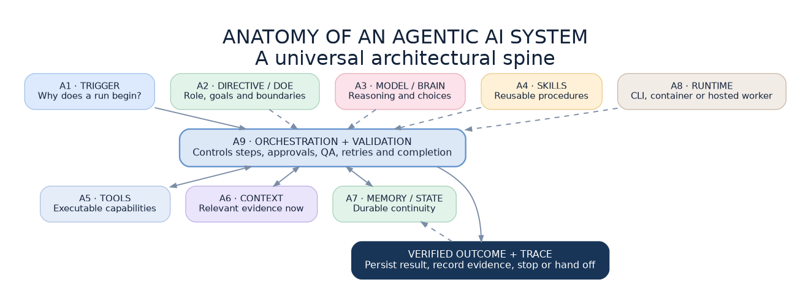

# Agent System Architect

A Claude Code skill for designing and reviewing AI agents the same way every time.

Most agent projects start as one big prompt and grow by accident. This skill gives Claude Code a fixed
standard to work from, the Universal Agentic AI Anatomy Framework, so that "build me an agent" or "is my
agent built properly?" gets a structured answer instead of a guess.



## The idea in one minute

An agent is a system, not a model and not a prompt. It has nine parts:

| | Part | The question it answers |
|---|---|---|
| A1 | Trigger | Why start or resume? |
| A2 | Directive | Who are you and what are the boundaries? |
| A3 | Model | Who interprets ambiguity and chooses the next step? |
| A4 | Skills | What reusable methods apply? |
| A5 | Tools | What can actually happen? |
| A6 | Context | What does the model need right now? |
| A7 | Memory and state | What must survive a run? |
| A8 | Runtime | Where do code and tools execute? |
| A9 | Orchestration and validation | How does work finish safely and correctly? |

Think of a digital worker: a job description (directive), a brain (model), training manuals (skills),
equipment (tools), case files (context), a filing cabinet (memory), a workplace (runtime) and a manager
who checks the work (orchestration and validation).

The useful promise is not "it thinks". It is "it works reproducibly, with evidence, oversight and
observable outcomes".

## What the skill does

Run `/agent-system-architect` in any project and choose one of two jobs.

**Review an existing agent.** Claude Code inspects the real code, configuration, skills, tools, state and
tests, then reports:

- each of the nine parts as present, partial, missing or unknown, with file-path evidence
- the ten reliability rules, one by one (run ids, tool permissions, untrusted content, approvals,
  safe retries, limits, provenance, data scope, versioning, proof by test)
- a score out of 18 on the design rubric
- one real task traced end to end, showing where state or evidence is lost
- a ranked list of small improvements, each with a test that proves it

**Design a new agent.** It follows the framework's design method: clarify the objective, find where
judgement is really needed, and pick the smallest architecture that works. A single model call comes
first, then a fixed workflow with a few model steps, then one tool-using agent, and multiple agents only
when there is a measured reason.

It is read-only. It does not deploy, send, install tools or change permissions. It hands you a plan and
the decisions that are yours to make.

## Install

For every project on your machine:

```bash
git clone https://github.com/mikekwal/agent-system-architect.git ~/.claude/skills/agent-system-architect
```

For one repository only, copy `SKILL.md` to `.claude/skills/agent-system-architect/SKILL.md` and copy
`framework/` to `architecture/` in that repository.

Start a new Claude Code session, then run:

```
/agent-system-architect
```

The skill only runs when you call it by name.

## What is in the box

| Path | What it is |
|---|---|
| `SKILL.md` | The skill itself |
| `framework/AGENTIC_AI_ANATOMY.md` | The nine parts, the ten reliability rules, when to split into more agents |
| `framework/00_START_HERE.md` | How a person or a coding assistant should use the framework |
| `framework/docs/` | Eight short guides: directives, skills and tools; orchestration; memory and learning; local and cloud; security; evaluation; the design method; a five-minute teaching guide |
| `framework/templates/` | Fill-in templates for a directive, a skill, a tool, a workflow, a handoff and an architecture review |
| `framework/contracts/` | JSON Schemas for an agent design manifest and a standard run result |
| `framework/diagrams/` | The spine, the agent loop and the runtime boundaries, as editable Mermaid and as images |

## Five things it will stop you doing

1. Treating a long prompt as an agent.
2. Adding a subagent for every step. Default to one agent with several skills.
3. Putting fixed rules in a prompt. If a rule must always hold, it belongs in code.
4. Calling logs "learning". Improvement needs evaluation, review and versioned changes.
5. Believing a document. What an agent does is proven by code, tests and observation, not by a spec.

## Works with

Claude Code skills (`SKILL.md`). The framework itself is plain Markdown, JSON, YAML and Mermaid, so other
coding assistants can read it too.

## About

Built by Mike Kwal at MK-Way while building an AI business development agent and deciding it should be
built properly. The framework is deliberately domain-neutral: same architecture, not the same agent.
